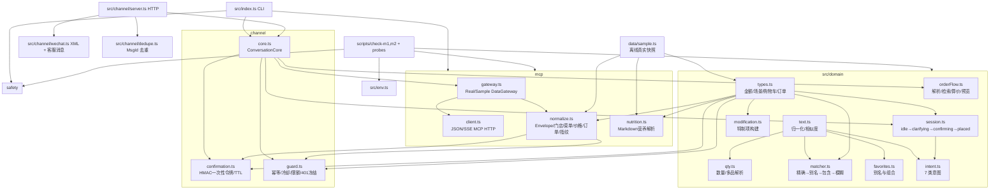

# mcd-txt-order CodeGraph

> 最近重扫：2026-10-11
>
> 基于当前工作树源码与 CodeGraph 索引；`.env` 与 `.cache/probe/` 只作为运行数据/凭据边界，不展开内容。

## 1. 项目边界

| 区域 | 文件数 | 作用 |
|---|---:|---|
| `src/domain` | 9 | 领域类型、订单流程、文本/数量解析、匹配、收藏、会话、意图 |
| `src/mcp` | 4 | MCP 客户端、gateway、归一化、营养解析 |
| `src/channel` | 6 | 对话核心、微信 HTTP 服务、XML/客服消息、加解密、消息去重、网页模拟器 |
| `src/safety` | 4 | HMAC 确认令牌、幂等/冷却/限额、持久化订单状态、对外错误脱敏 |
| `src/data` | 1 | 菜单快照与合成门店生成的离线示例数据 |
| `src` 根目录 | 2 | CLI 入口与环境变量读取 |
| `scripts` | 17 | M1–M4/M8/S9 自检、探针、样例生成、报名检查与 Token 配置 |
| 文档/配置与索引 | 32 | 规格、计划、审计、微信方案、部署配置、fixtures、CI 与 CodeGraph |

## 2. 模块图



## 3. 关键导入边

```text
src/domain/text.ts
  ├─> qty.ts
  ├─> matcher.ts
  ├─> favorites.ts
  └─> intent.ts

src/domain/types.ts
  ├─> modification.ts
  ├─> session.ts
  ├─> mcp/normalize.ts
  ├─> mcp/nutrition.ts
  ├─> safety/confirmation.ts
  └─> safety/guard.ts

src/safety/confirmation.ts
  └─> mcp/normalize.ts (cartFingerprint)

src/safety/guard.ts
  └─> mcp/normalize.ts (cartFingerprint)

src/env.ts
  ├─> domain/favorites.ts
  └─> scripts/*

src/data/sample.ts
  ├─> scripts/check-m1.ts
  └─> scripts/check-m2.ts (SAMPLE_STORES)
```

## 4. 运行时主流程

```text
用户文本 → ChannelServer / CLI → ConversationCore.handle
  → classifyIntent
  → buildPreview（门店/餐品匹配 → DataGateway 查询 → 特制详情 → 算价）
  → issue 确认令牌 → SessionStore.toConfirming
  → 用户显式确认
  → consume 令牌 → OrderGuard.evaluate + begin
  → DataGateway.createOrder
  → guard.succeed / fail → SessionStore.toPlaced / idle

微信入口：签名校验 → XML 解析 → MsgId（或 FromUserName+CreateTime）去重 → 5 秒回复时限；超时先回 success，再尝试客服消息异步推送。
```

金额边界：菜单价格经 `centsFromYuanString` 转为分；算价结果经 `centsFromCentsInt` 保持分；领域层统一使用 `*Cents`。

## 5. 当前结构性发现

1. 当前项目目录为 `mcd-txt-order`；此前的 `mcd-smart-order` 目录现已为空。该工作树包含 `src/channel/server.ts`、`src/channel/wechat.ts`、`src/channel/crypto.ts`、`src/channel/dedupe.ts` 等微信接入模块。
2. 微信服务已接入签名验证、XML/CDATA 解析、消息去重、请求体 1 MiB 上限、5 秒请求超时、每分钟限流与被动回复超时处理；读取代码并不代表已验证微信 UAT 或外部回调。
3. 对话核心的下单路径已连接确认令牌、限额/幂等守卫与 `gateway.createOrder`；生产模式默认使用 SQLite 订单尝试存储，进程重启或多实例共享文件时保留 pending/succeeded/failed/unknown 状态。
4. CodeGraph 当前识别 `ConversationCore` 有 14 个调用方；`parseWechatXml`、`wechatVerify`、`wechatMessage`、`OrderGuard` 的入口与调用范围已重新核对；`OrderGuard` 有 6 个调用方（自检脚本与对话核心）。
5. `.env` 未读取或展开；继续保持凭据不进入文档、日志或版本控制。

## 6. CodeGraph 索引结果

本次对原目录和新目录分别执行了索引同步：

- 索引文件：`.codegraph/`
- 原目录 `mcd-smart-order` 已为空；其索引同步后显示 0 文件、0 节点、0 边。
- 当前目录 `mcd-txt-order` 索引已更新且 up-to-date：45 个源码/配置文件、1,237 个节点、3,947 条边；CodeGraph 版本 1.6.0，SQLite WAL 后端。
- 本次复核同步：3 个修改文件，更新 106 个节点；此前提交导入时的批量同步记录仍保留在 Git 历史中。
- 核心入口查询识别 97 个符号，覆盖 8 个文件；订单下单/幂等查询识别 108 个符号，覆盖 6 个文件；微信安全入口查询识别 90 个符号，覆盖 5 个文件。

交互式查询确认的调用/影响范围：

- `src/index.ts` 与 `src/channel/server.ts` 都复用 `ConversationCore`，分别提供 CLI 和 HTTP/微信公众号入口。
- `ConversationCore.place` 先消费绑定用户与购物车指纹的令牌，再执行守卫 `evaluate`/`begin`，最后调用 `gateway.createOrder`；调用点已由索引确认。
- 微信消息路径：`ChannelServer.wechatMessage` → `parseWechatXml` / `dedupeKeyOf` → 对话核心；超时分支使用客服消息发送函数。
- 查询到微信服务代码与 M4 自检脚本；本次只同步和审阅索引，未运行 M1–M4 自检。
