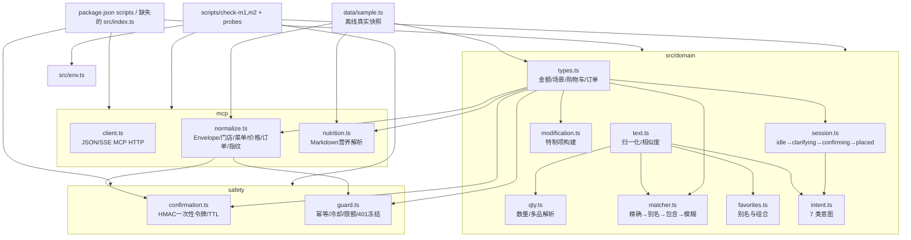

# mcd-txt-order CodeGraph

> 最近重扫：2026-10-10
>
> 基于当前工作树源码与 CodeGraph 索引；`.env` 与 `.cache/probe/` 只作为运行数据/凭据边界，不展开内容。

## 1. 项目边界

| 区域 | 文件数 | 作用 |
|---|---:|---|
| `src/domain` | 8 | 纯领域模型、文本/数量解析、匹配、收藏、会话、意图 |
| `src/mcp` | 3 | MCP Streamable HTTP 客户端、响应归一化、营养数据解析 |
| `src/safety` | 2 | HMAC 确认令牌、幂等/冷却/限额/鉴权失败守卫 |
| `src/data` | 1 | 真实探针快照生成的离线示例数据 |
| `scripts` | 8 | M1/M2 离线自检、探针、样例生成与 Token 配置 |
| 文档/配置 | 15 | 规格、计划、审计、微信方案、示例配置 |
| `.cache/probe` | 25 | MCP 只读探针快照；不属于运行时模块 |

## 2. 模块图



## 3. 关键导入边

```text
src/domain/text.ts
  ├─> qty.ts
  ├─> matcher.ts
  ├─> favorites.ts
  └─> intent.ts

src/domain/types.ts
  ├─> modification.ts
  ├─> session.ts
  ├─> mcp/normalize.ts
  ├─> mcp/nutrition.ts
  ├─> safety/confirmation.ts
  └─> safety/guard.ts

src/safety/confirmation.ts
  └─> mcp/normalize.ts (cartFingerprint)

src/safety/guard.ts
  └─> mcp/normalize.ts (cartFingerprint)

src/env.ts
  ├─> domain/favorites.ts
  └─> scripts/*

src/data/sample.ts
  ├─> scripts/check-m1.ts
  └─> scripts/check-m2.ts (SAMPLE_STORES)
```

## 4. 运行时主流程

```text
用户文本
  → intent.classifyIntent
  → favorites.resolveStoreAlias / qty.parseItemSpecs
  → matcher.resolveItemText / pickOne
  → MCP query-nearby-stores
  → MCP query-meals
  → （特制）query-meal-detail + modification.buildModification
  → normalize.parsePrice
  → session.toConfirming
  → confirmation.issue / guard.evaluate
  → 用户显式确认
  → confirmation.consume / guard.begin
  → MCP create-order（当前源码未见编排入口）
  → guard.succeed 或 guard.fail
  → session.toPlaced / toIdle
```

金额边界：菜单价格经 `centsFromYuanString` 转为分；算价结果经 `centsFromCentsInt` 保持分；领域层统一使用 `*Cents`。

## 5. 当前结构性发现

1. 已补上 `src/index.ts`、`src/channel/core.ts`、`src/domain/orderFlow.ts`、`src/mcp/gateway.ts` 等入口与编排模块；原先“没有产品入口/编排层”的断点已关闭。
2. 运行链现为 `src/index.ts` → `ConversationCore` → `buildPreview` / `DataGateway`，MCP 与 Sample Gateway 都通过同一领域接口提供数据。
3. 下单链已在 `ConversationCore` 接入：预览时签发令牌并进入确认态；确认时调用 `OrderGuard` 和 gateway，成功后完成会话迁移，失败不自动重试。
4. `src/domain`、`src/mcp`、`src/safety` 仍由离线自检脚本直接验证；CodeGraph 检索到 MCP client 现有 20 个调用点（探针与运行模块）。
5. `.env` 存在于工作树，未在本图中读取或展开；应继续保持凭据不进入文档、日志或版本控制。

## 6. CodeGraph 索引结果

已在工作树运行 `codegraph sync`（增量更新）：

- 索引文件：`.codegraph/`
- 此次变更：9 个文件（新增 6、修改 3）
- 此次新增/更新节点：275
- 当前 MCP 查询识别：70 个符号、5 个源码文件

交互式查询确认的调用/影响范围：

- `src/index.ts` 现在创建 `ConversationCore` 并提供 CLI 命令入口；演示脚本会刻意停在预览，不替用户确认。
- `ConversationCore.startOrder` 调用 `buildPreview`，生成确认令牌并调用 `SessionStore.toConfirming`；`place` 是实际写操作的编排位置。
- `ConversationCore` 统一持有 `SessionStore`、`ConfirmationService`、`OrderGuard` 和 gateway，当前仍是内存态实现。
- `src/channel/core.ts` 是渠道无关的对话核心；仍未在索引内找到独立的微信公众号 HTTP/XML 接入模块。
