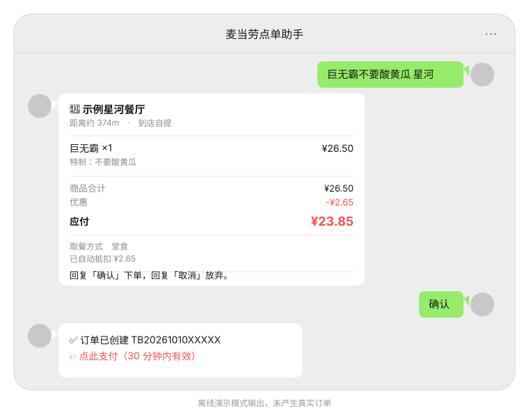

# mcd-txt-order

> 在微信里**一句话**下单麦当劳：预置喜爱的门店与餐品，发送「巨无霸 星河」，自动检索门店与菜单、算出真实应付价，确认后返回支付链接。
>
> 基于麦当劳中国官方 MCP（`https://mcp.mcd.cn`）构建。**零第三方依赖**，Node 原生运行 TypeScript（需 **≥ 22.22.2**，订单幂等存储依赖内置 `node:sqlite`）。



<details>
<summary>纯文本版对话</summary>

```
你    巨无霸不要酸黄瓜 星河
助手  📍 示例星河餐厅
      距离约 374m

      · 巨无霸 ×1  ¥26.50
        特制：不要酸黄瓜

      商品合计  ¥26.50
      优惠      -¥2.65
      应付      ¥23.85

      取餐方式  堂食
      回复「确认」下单，回复「取消」放弃。

你    确认
助手  ✅ 订单已创建
      👉 点此支付（30 分钟内有效）
```

</details>

---

## 为什么做这个

麦当劳 MCP 开放了完整的点餐能力，但它目前只在 AI 对话框里能用。而真正高频的场景是：**我知道我要吃什么，我只是不想再翻一遍 App。**

于是这个项目把 MCP 接到一个零安装的入口上 —— 你自己的微信公众号。关注即用，一句话搞定，不用下载 App，不用找小程序，不用扫码。

**它不是麦当劳官方产品**，是一个由 MCP 能力驱动的第三方助手。

---

## 快速开始

### 不需要 Token 也能玩

```bash
git clone https://github.com/An61/mcd-txt-order.git
cd mcd-txt-order
node --experimental-strip-types scripts/check-m1.ts   # 领域内核自检（60 项）
node --experimental-strip-types scripts/check-m2.ts   # 安全与会话自检（83 项）
```

两条命令全程离线，不发任何网络请求。仓库自带一份**由本地菜单快照和合成门店生成的示例数据（5 家合成门店、115 条历史菜单）**，所以没有 Token 也能离线演示匹配流程。

### 接上自己的 Token

1. 打开 https://open.mcd.cn/mcp ，手机号登录 → 控制台 → **激活** → 复制 Token
2. 复制配置模板并填入：

```bash
cp .env.example .env
# 编辑 .env，填入 MCD_MCP_TOKEN、PROBE_CITY、PROBE_KEYWORD；后三项齐备才会执行 M3 真实只读链路
```

`.env` 已被 `.gitignore` 排除，**永远不会进仓库**。

3. 体检 + 连通性验证：

```bash
npm run doctor
```

```
Node            v22.22.2
MCP Token       CX5E****mXHS
兜底城市        示例市
门店/餐品       3 / 6

正在连接 MCP …
✅ 连接成功，服务端提供 35 个工具
   ✅ query-nearby-stores   ✅ query-meals
   ✅ query-meal-detail     ✅ calculate-price
   ✅ create-order
```

> **兜底城市是必需项**：实测门店检索要求 `city` 与 `keyword` 同时给出（缺一报 `600058`），
> 而用户口语句里常常不带城市。请在 `.env` 设 `MCD_DEFAULT_CITY`，
> 或在 `config/favorites.json` 配 `rules.defaultCity`。

---

## 使用示例

### 命令行

| 命令 | 作用 |
|---|---|
| `npm run chat` | 交互式对话（无 Token 自动进演示模式，每条回复都会标注） |
| `npm run demo` | 离线演示。**刻意停在预览这一步，绝不自动替你按下确认** |
| `npm run doctor` | 环境体检：Token、城市、收藏、MCP 连通性 |
| `npm run favorites` | 查看已配置的门店与餐品别名 |
| `npm run tools` | 列出 MCP 当前**实时**提供的工具（实测 35 个，比 README 多） |
| `npm run serve` | 起 HTTP 服务，`/` 是网页模拟器，`/wechat` 是公众号回调 |
| `npm run check` | 跑全部离线自检（M1/M2/M4/M8 + M3 离线编排 + release scan）；有 Token 时 M3 额外执行只读远端链路，绝不调用 `create-order` |
| `npm run typecheck` | 使用锁定的 TypeScript 与 Node 类型定义执行 `tsc --noEmit` |
| `npm run check:s9:a1` | 验证 SQLite 订单 claim 的跨进程互斥、重启回放和 `unknown` 终态 |
| `npm run check:s9:boundaries` | 验证支付 URL、MCP 传输、body 上限和应用限流 |
| `npm run check:deploy` | 验证 Docker/Compose/Caddy/Nginx/systemd 的部署结构边界 |
| `npm run check:release` | 只跑推送前礼节检查：凭据、手机号、支付链接、误入库的 `.env` |
| `npm run ip` | 查公网出口 IP —— 填进公众号 IP 白名单，否则客服接口报 40164 |

### 网页模拟器

```bash
npm run serve          # 然后浏览器打开 http://localhost:8787
```

单文件、零外部资源、断网也能用。**没有 Token、没有公众号，也能完整走一遍**「找店 → 匹配 → 算真实价 → 预览」，
页面会明确标注当前是演示模式还是真实模式。

### 接入自己的公众号

```bash
npm run serve                    # 起服务
ngrok http 8787                  # 微信只回调 80/443 的公网 HTTPS
```

把 `.env` 里的 `WECHAT_TOKEN` 填成和公众号后台「服务器配置」一致的值，
再把穿透出来的 `https://xxx/wechat` 填回公众号后台即可。

三个已知的平台约束，代码里都处理了：

| 约束 | 处理方式 |
|---|---|
| **5 秒不响应微信就断连并重试 3 次** | 来不及就回 `success`（官方推荐，可抑制重试），后台跑完用客服消息推回；按 `MsgId` 去重兜底 |
| **客服消息有 48 小时窗口** | 本项目推送发生在用户发言后数秒内，天然在窗口内 |
| **个人订阅号没有客服消息权限** | 降级为「用户下次发言时把结果补上」，功能完整、体验略打折 |

**15 分钟接完的分步手册**：[`docs/WECHAT_SETUP.md`](docs/WECHAT_SETUP.md)（配置 → 穿透 → 填后台 → 发第一句话 → 排错表）。
**方案选型**（测试号 / 订阅号 / 企业微信，以及为什么不需要麦当劳的开发权）：[`docs/WECHAT_TESTING.md`](docs/WECHAT_TESTING.md)。
**放到公网正式上线**：[`docs/WECHAT_PRODUCTION.md`](docs/WECHAT_PRODUCTION.md)（TLS、加解密模式、IP 白名单、灰度回滚、上线检查清单）。

### 生产级能力（不只是能跑）

| 能力 | 说明 |
|---|---|
| **消息加解密** | 支持明文 / 兼容 / 安全三种模式。安全模式下 `echostr` 也是密文、回复也必须加密，这些坑都处理了 |
| **调试入口自动隔离** | `HOST=0.0.0.0` 对外监听时，网页模拟器与 `/api/chat` 自动关闭（它们无需验签即可驱动下单链路） |
| **部署产物** | `deploy/` 下 Docker + Caddy（自动 HTTPS）、Nginx、systemd unit 三套，开箱即用 |
| **快速失败** | 安全模式缺密钥时直接拒绝启动，而不是等第一条消息进来才报错 |

### 真实链路跑出来的样子

有 Token 时 `npm run chat` 走的是真实数据：

```
你    巨无霸不要酸黄瓜 星河
      📍 示例星河餐厅
         距离约 374m
      · 巨无霸 ×1  ¥26.50
          特制：不要酸黄瓜
      商品合计  ¥26.50
      应付      ¥26.50
      取餐方式  堂食
      回复「确认」下单，回复「取消」放弃。
```

`getMenu` 实时拉到 **122 项**菜单，`takeWayCode` 从 `calculate-price` 取到 `eat-in` / `take-in-store`。

### 对话指令

| 你说 | 它做什么 |
|---|---|
| `巨无霸 星河` | 按别名找店 → 找菜 → 算真实价 → 出预览卡片 |
| `两个巨无霸一杯可乐 星河` | 解析数量与多品，逐项匹配 |
| `巨无霸不要酸黄瓜 星河` | 触发额外一次详情查询，取到官方特制 code 再下单 |
| `餐品:巨无霸 餐厅:星河餐厅 堂食` | 用显式角色和场景检索门店、实时菜单并选择堂食取餐方式 |
| `家 外卖 巨无霸` | 通过已确认的地址簿引用检索可配送门店；没有 `addressId` 时安全阻断 |
| `确认` / `好的` / `OK` | 二次确认后才真正调用 create-order |
| `算了` / `取消订单` | 作废当前预览，不产生任何写操作 |
| `1` / `第一个` | 在多个候选餐品里选一个 |
| `附近有啥店` / `我有什么券` / `巨无霸多少热量` | 只读查询，不碰任何写接口 |

外卖地址只接受地址簿或 `delivery-query-addresses` 已确认的 `addressId`。本项目不从自由文本猜地址、不自动创建配送地址；渠道接入时通过 `ConversationCore` 的 `deliveryAddressResolver` 注入用户与 provider scope 绑定的解析器。

S10 的本地门禁：

```text
npm run check:s10:a3   # 候选会话、TTL、越权和一次性选择
npm run check:s10:a4   # 场景、地址、实时门店和取餐方式
npm run check:s10:a5   # 价格变化、重新确认和幂等指纹
npm run check:s10:a6   # 合成夹具、文档入口和 release 约束
```

### 预置喜爱

编辑 `config/favorites.json`（可从 `favorites.example.json` 复制）：

```json
{
  "stores": [
    { "alias": ["星河", "xinghe"], "name": "示例星河餐厅", "city": "示例市" }
  ],
  "meals": [
    { "name": "巨无霸", "alias": ["jwb", "巨无"], "defaultSpec": "不要酸黄瓜" }
  ]
}
```

**设计取舍**：门店真身依赖官方收藏能力（云端，不会过期），本地只维护「别名 → 官方名称」的映射。所以 `favorites.json` 里存的是**别名字典**，不是写死的门店清单。

---

## 安全设计

`create-order` 会产生**真实订单和真实支付链接**。一句话触发付钱，听起来方便，做起来必须苛刻。五道闸：

| 闸 | 做法 |
|---|---|
| **状态机** | `已下单` 状态只能由 `待确认` 进入。不是"记得判断"，是别的路径根本走不过去 |
| **确认令牌** | HMAC-SHA256 绑定 `userId + 购物车指纹 + 有效期`；一次性消费；5 分钟过期；购物车一改立刻作废 |
| **守卫** | 幂等 + 60 秒冷却 + 每小时 3 笔 / 每天 8 笔 + 单笔 ¥200 / 每日 ¥500 上限 |
| **失败不重试** | `create-order` 失败就停在终态。**宁可让用户重说一遍，也不能下出第二笔** |
| **凭据隔离** | Token 只走环境变量；仓库内配置全是占位符；401 立刻冻结一切写操作 |

还有一条容易被忽略的：微信公众号**在 5 秒收不到响应时会重发，总共三次**，也就是说同一句「确认」最多会被投递 4 次。本项目按官方推荐做 `MsgId` 去重，并用购物车指纹做确定性幂等 —— 不是"几秒内去重"这种靠运气的写法。

---

## 目标用户

- **固定口味族**：每天都吃那几样，不想再翻菜单的人
- **赶时间的人**：开车路上、地铁上，一句话下单到店就取
- **不想装 App 的人**：临时想吃、低频用户、长辈
- **开发者**：想看一份"MCP 怎么真正用到产品里"的完整实现，尤其是对面上那些文档没写的坑

---

## 延伸阅读

| 文档 | 内容 |
|---|---|
| [`docs/PROGRESS.md`](docs/PROGRESS.md) | **当前进度快照**：主链路哪几步已真实跑通、哪几步还没验证、实测数据与下一步顺序 |
| [`docs/TECHNICAL_NOTES.md`](docs/TECHNICAL_NOTES.md) | **技术要点长文**：实测挖出的 5 个文档未记载的坑、下单链路为何被锁死、真钱之前的五道闸。做 MCP 集成的话建议先看这篇 |
| [`docs/WECHAT_SETUP.md`](docs/WECHAT_SETUP.md) | 公众号接入分步手册（15 分钟接完，含排错表） |
| [`docs/WECHAT_TESTING.md`](docs/WECHAT_TESTING.md) | 测试路径选型：为什么不需要麦当劳的公众号开发权 |
| [`docs/WECHAT_PRODUCTION.md`](docs/WECHAT_PRODUCTION.md) | **上线手册**：域名与 HTTPS、加解密模式、IP 白名单、上线检查清单、灰度与回滚 |
| [`MCP_INTEGRATION.md`](MCP_INTEGRATION.md) | 用到的 MCP 工具清单与调用流程 |

---

## 项目结构

```
src/
├── mcp/
│   ├── client.ts       零依赖 Streamable HTTP 客户端（JSON + SSE 双解析）
│   ├── gateway.ts      真实 / 演示双网关，**不允许静默降级**
│   ├── normalize.ts    容忍式字段归一（多层级、同义字段名）
│   └── nutrition.ts    营养 Markdown 解析器
├── domain/
│   ├── types.ts        领域模型（金额一律用「分」）+ SCENES 场景映射表
│   ├── text.ts         文本归一化（全半角、客套话、相似度）
│   ├── qty.ts          数量与多品解析
│   ├── matcher.ts      四级降级匹配 + 菜单感知的「品名+特制」切分
│   ├── favorites.ts    收藏与别名
│   ├── modification.ts 特制翻译器
│   ├── session.ts      会话状态机（`已下单` 只能由 `待确认` 进入）
│   ├── intent.ts       七类意图识别
│   └── orderFlow.ts    检索→菜单→详情→算价→预览 编排
├── safety/
│   ├── confirmation.ts 一次性确认令牌
│   └── guard.ts        幂等 / 冷却 / 限额
├── channel/
│   ├── core.ts         渠道无关的会话核心（钱只在这条链路上被花出去）
│   ├── mock.ts         网页模拟器：单文件 HTML，零外部资源
│   ├── wechat.ts       验签 / XML / 被动回复 / 客服消息（不含任何业务逻辑）
│   ├── server.ts       HTTP 服务：`/` `/api/chat` `/wechat` `/healthz`
│   └── dedupe.ts       MsgId 去重（微信 5 秒重试 3 次的防线）
├── index.ts            CLI 入口
└── data/sample.ts      由本地菜单快照和合成门店生成的示例数据
```

---

## 开发进度

| 阶段 | 内容 | 状态 |
|---|---|---|
| M0 | MCP 客户端、鉴权、探针 | ✅ |
| M1 | 领域内核（匹配、数量、营养、示例数据） | ✅ 60 项自检通过 |
| M2 | 安全红线与会话状态机 | ✅ 83 项自检通过 |
| M3 | 下单编排 + 会话核心 + CLI 入口 | ✅ 27 项离线自检；配置真实探针后 36 项（含真实只读链路） |
| M4 | 渠道层（模拟器 / 验签 / XML / 5 秒异步 / 去重） | ✅ 74 项自检通过 |
| M5 | 参赛文件 | ✅ README / CONTEST_DECLARATION / MCP_INTEGRATION / workbuddy.md 已备齐 |
> 本仓库是「麦当劳程序员节创意开发大赛」参赛作品。提交 `CONTEST_DECLARATION.md` / `MCP_INTEGRATION.md` 等文件均按要求放置。

## License

MIT
